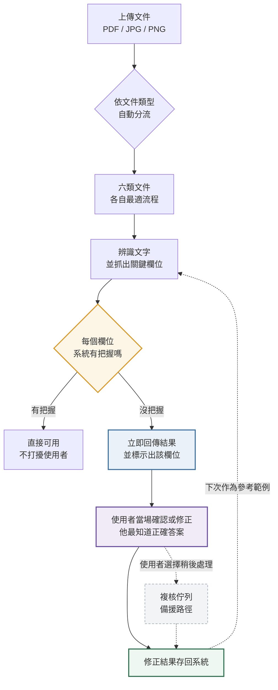
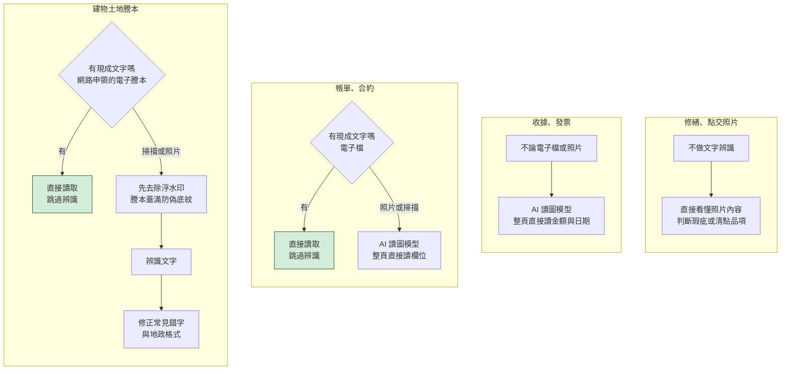
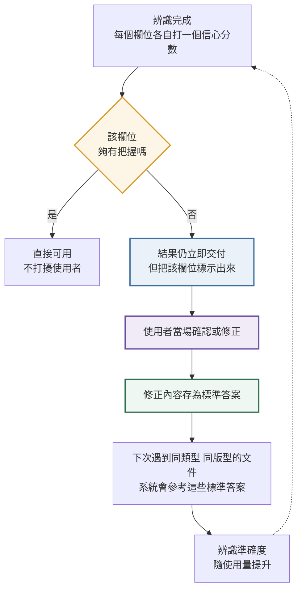

# DocuMind 圖片文字辨識流程說明（行銷版）

> **對象**：行銷、業務、提案人員
> **用途**：對外說明產品怎麼運作、跟一般 OCR 差在哪
> **最後更新**：2026-11-13

本文不含技術細節，可直接取用於簡報與提案。文中數字分兩種：「預估」是目標或推算，「實測」是小樣本量測、附日期與樣本數。使用規範見文末〈對外說明的注意事項〉，提案前請務必先看。

---

## 一句話總結

**使用者上傳文件 → 系統依文件類型用最適合的方式辨識 → 沒把握的地方主動交給人確認 → 人的修正回存系統，下次更準。**

關鍵差異不是「辨識得多準」，而是**系統會評估自己哪裡可能不準，並且會說出來**。
限制：掃描件、照片上被讀錯的字，可能帶著高分數混過去，不一定會被標出來（見〈揪出「看起來合理但其實錯了」〉）。

---

## 支援的文件與產出

| 文件類型 | 系統自動抓出的欄位 | 適用場景 |
|---|---|---|
| **建物土地謄本** | 電子謄本上印的每一項：標示部（地號、建號、門牌、面積、層次、附屬建物、共有部分、使用分區、公告土地現值…）、所有權部（所有權人、權利範圍、權狀字號、申報地價…）、他項權利部（抵押權人、擔保債權總金額、存續期間…），並判讀有無他項權利、限制登記、信託 | 不動產估價、產權查核 |
| **帳單** | 金額、日期、戶號 | 水電費、管理費核銷 |
| **收據、發票** | 金額（整張總計）、日期 | 費用核銷、記帳 |
| **合約** | 合約編號、簽訂／生效日期、甲方、乙方、金額、幣別；租約另抓租期起訖、月租金、押金、租賃地址、承租人 | 合約管理、租賃建檔 |
| **修繕照片** | 瑕疵標籤（漏水、壁癌、龜裂、設備損壞）、受損物件、狀況描述 | 物件修繕評估、保險理賠 |
| **點交照片** | 空間（客廳、臥室…）、照片裡的家具與家電、狀況描述；品項只回點交清單詞彙表裡有的 | 租屋點交清點 |

**上傳規格**：PDF、JPG、PNG，單檔 20 MB 以內。多頁 PDF 會逐頁處理。修繕、點交照片僅接受影像，不接受 PDF。

### 另外兩項可以講的能力

| 能力 | 說明 |
|---|---|
| **文件內容問答** | 上傳時可一併提問（例如「合約金額是多少？」），系統依辨識結果回答，不必自己翻文件找 |
| **文件類型自動建議** | 系統會判讀並建議文件類型，減少選錯的機會；最終仍以使用者指定為準。目前能建議謄本、合約、收據，帳單不會被建議 |

---

## 流程圖一：整體流程

---

## 流程圖二：六類文件各走各的路

一般 OCR 產品是「一套流程通吃所有文件」。DocuMind 針對每一類文件用不同做法，因為它們的難點完全不同。

**四個可以對外講的設計亮點：**

1. **電子檔直接讀現成文字** — 網路申領的電子謄本、數位產製的帳單與合約 PDF 本身就帶文字，系統直接讀取、跳過辨識，**又快又不花辨識成本**（電子謄本整份不到 0.1 秒，實測見〈效益與規格數字〉）。收據不走這條，一律交 AI 讀圖。
2. **掃描的謄本先去浮水印** — 謄本印滿防偽底紋，直接丟給一般 OCR 會把底紋讀成亂碼。
3. **帳單、合約、收據的照片與掃描件交 AI 讀圖** — 這類文件版面五花八門，由看得懂版面的 AI 讀圖模型整頁直接讀出欄位，不先辨識文字再找欄位。
4. **修繕、點交照片不走文字辨識** — 照片上本來就沒字，走的是「看懂影像內容」，直接判斷是漏水還是壁癌、房間裡有哪些家具家電。點交品項只回清單上有的，寧可漏報、不憑空多報。

---

## 流程圖三：越用越準的機制

這是本產品最核心、也最好講的部分。

### 三個對外賣點

**一、寧可承認不確定，也不硬猜。**
系統對每個欄位分別評分，只要有**任何一個**欄位沒把握，整份就排入人工複核。採最保守的判斷方式——不會因為其他欄位都很準，就讓有問題的欄位混過去。
**但這不會拖慢使用者**：結果一律立即回傳，複核在背景進行。

**二、人的修正不會白費。**
每一次人工修正都被存成標準答案。下次遇到同類型、同版型的文件，系統會拿這些答案當參考。**使用者用得越多，系統越準，而且不需要重新訓練模型、不需要額外費用。**（提升幅度尚未量測。）

**三、使用者就是最佳確認者。**
低信心欄位由**使用者當場確認**，不必養一組後台審查團隊。使用者是文件當事人、最知道正確答案。系統也不會拿自己的辨識結果來教自己——只有真人確認過的修正才會進入學習池。

---

## 揪出「看起來合理但其實錯了」

這是本產品與通用 AI 最根本的差別，值得單獨講，也要講清楚做到哪裡。

傳統 OCR 讀錯會產生亂碼，肉眼一看就知道有問題。**生成式 AI 讀錯則會產生語法通順、格式正確、但數字是錯的內容**——拼字檢查抓不到，人也看不出來。這種錯誤一旦流入估價或合約建檔，代價很高。

**現在做到的：格式檢查。** 系統會檢查每個欄位的值像不像該有的樣子，例如面積、金額欄位出現地號的形狀、日期讀不成日期、編號欄位裡沒有數字。不像的就壓低信心並標示出來，交給人確認。這個訊號**不依賴 AI 自己說它有多確定**。

**還擋不住的：** 字被讀成另一個看起來合理的字（例如「土」讀成「上」、金額 23 讀成 25），格式檢查抓不到，可能帶著高分數混過去。2026-10-20 實測：5 份真實電子謄本轉成模擬掃描與拍照圖（17 頁），讀錯的 23 欄中有 16 欄沒被標出來。

**兩套辨識引擎逐欄交叉比對：功能已做好，目前線上沒有開**（線上只跑一套辨識引擎），不可對外說成現有能力。

---

## 效益與規格數字

> **準確率還沒有大樣本的基準測試。** 下表的實測數字都是小樣本，引用時要連同日期與樣本數一起講，不可說成統計結果。

| 項目 | 數字 | 狀態 | 依據 |
|---|---|---|---|
| 電子謄本欄位正確率 | 逐欄對照的 3 份全對；5 份共 640 個原文值 0 不符 | `實測` | 2026-10-14～15 線上，5 份真實電子謄本 |
| 掃描、拍照謄本 25 個主要欄位正確率 | 約 **97%** | `實測` | 2026-10-20 線上，5 份電子謄本轉成模擬掃描與拍照圖（17 頁）；較難的手機斜拍照片另批實測只有 58%（2026-11-09，非線上） |
| 收據金額＋日期 | **41／44 欄** | `實測` | 2026-10-29 線上，22 張公開授權的台灣收據，3 次結果相同 |
| 帳單金額、日期、戶號 | **14／15 欄** | `實測` | 2026-10-29 線上，5 張帳單 |
| 合約欄位（照片與掃描件） | **81%**（90／111） | `實測` | 2026-10-29 線上，5 份合約，盲判 |
| 點交照片品項 | 照片上的品項找到 **76%**；回報的品項 **70%** 確實在照片上 | `實測` | 2026-11-13 本機，18 張照片各 3 次，盲判標準答案 |
| 處理時間：電子謄本 | 整份 **0.04–0.07 秒** | `實測` | 2026-10-15 線上，5 份，伺服器端計時 |
| 處理時間：掃描、拍照謄本 | 每頁約 **15–24 秒** | `實測` | 2026-09-21 線上；多頁照頁數累加 |
| 月營運成本 | **需個案試算** | `未試算` | 主機費加 AI 模型按量計費，依用量與部署方式而定；請找工程團隊試算 |
| 單檔上限 | **20 MB** | `已確認` | 系統實際限制 |
| 支援格式 | **PDF / JPG / PNG** | `已確認` | 系統實際支援 |
| 「越用越準」的提升幅度 | **未量測** | `預估` | 回饋機制已實作並可運作，但提升幅度尚無實測數據 |

---

## 常見問題

**Q：跟直接用 ChatGPT 讀文件差在哪？**
第一，通用 AI 讀錯的時候，會產生**看起來很合理但數字是錯的**結果，一般人看不出來；DocuMind 對每個欄位評分並做格式檢查，把沒把握或格式不對的欄位標出來（擋不住全部，見上一節）。第二，每類文件用各自的做法，電子檔直接讀現成文字，不靠 AI 猜。

**Q：資料會外流嗎？**
**目前的線上服務會把文件內容送到外部 AI 服務**：需要 AI 校正或補欄位的謄本頁、以及使用者的提問送 OpenAI；帳單、合約、收據、修繕與點交照片送 AWS Bedrock（東京區域）。
架構上可改為本地運行：辨識引擎本身就在本機執行，AI 層也可切換為本地模型（已實作，尚未啟用）。對個資敏感的客戶（不動產、金融）這是硬需求。
※ 兩點要注意：一、**修繕、點交照片、收據，以及帳單、合約的照片與掃描件，靠的是 AI 讀圖，全本地運行需要另外部署本地視覺模型**，不是把雲端關掉就會動。
二、正式的全本地運行驗收測試尚未完成，若客戶要寫進合約，請先找工程團隊確認。

**Q：辨識要多久？**
看文件有沒有現成文字：網路申領的電子謄本整份不到 0.1 秒；掃描或拍照的謄本每頁約 15–24 秒，多頁照頁數累加（實測見〈效益與規格數字〉）。對外請描述為「電子檔幾乎即時、掃描件每頁數十秒內」，不要給保證秒數。

**Q：一定要人工複核嗎？會不會拖慢流程？**
**不需要專門的複核人力。** 設計上由使用者當場確認低信心欄位——他是文件當事人，最知道正確答案。結果一律立即回傳，高信心欄位完全不需要操作。若使用者當下不想處理，可留待複核佇列稍後處理，那是備援而非主要路徑。門檻可依客戶需求調整——要求高就調嚴一點（更多進複核），求快就調鬆。

**Q：支援簡體中文或英文嗎？**
目前主力是**繁體中文**，並針對台灣地政用語、民國紀年、地號格式做過最佳化。其他語言需另行評估。

---

## 對外說明的注意事項 ⚠️

**預估值對外引用時必須加註「預估」二字；實測值必須連同日期與樣本數一起講，不可說成統計結果或保證值。**

| ✅ 可以這樣講 | ❌ 不可以這樣講 |
|---|---|
| 系統會針對每個欄位評估把握程度，沒把握的主動交由人工確認 | 系統會抓出所有錯誤 |
| 人工修正會回饋到系統，使用越久越準確 | 比 ChatGPT 準 X% |
| 架構上支援本地部署（照片與 AI 讀圖的部分需另外部署本地視覺模型） | 資料不會離開客戶的機器（目前線上服務會送外部 AI） |
| 2026-10-29 實測 22 張收據，金額與日期 44 欄讀對 41 欄（小樣本） | 準確率**達** 95%、保證單頁幾秒完成 |
| 電子檔直接讀現成文字，不經辨識 | 兩套辨識引擎交叉比對（線上沒有開） |
| | 任何沒標「預估」、或沒附日期與樣本數的百分比或秒數 |

---

## 需要更多素材時

| 需求 | 找誰／看哪裡 |
|---|---|
| 實際辨識效果截圖 | 請工程團隊提供 demo 環境操作畫面 |
| 準確率與速度實測紀錄 | `docs/testing/`（各份紀錄的索引在 `docs/README.md`） |
| 部署方式與成本 | `docs/DEPLOYMENT.md` |
| 客製化文件類型可行性 | 請工程團隊評估，架構上支援擴充 |
